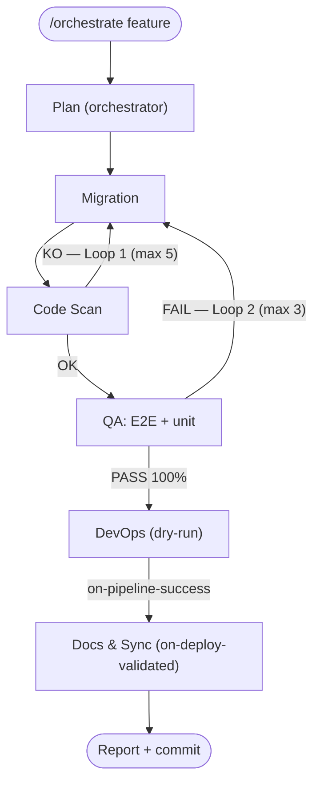
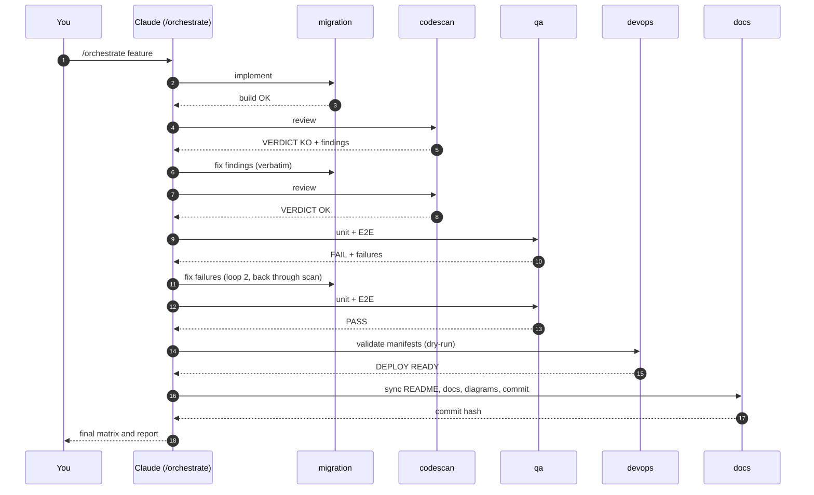
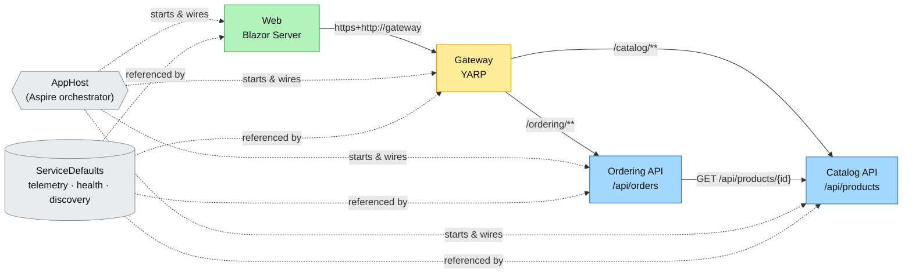

# ECommerce — .NET Aspire app with a 7-agent Claude Code workflow

`src/` holds a .NET 10 microservices e-commerce demo orchestrated by .NET Aspire. `.claude/` holds a set of **Claude Code sub-agents and slash commands** (Markdown only, no scripts) that take a feature from plan to code, quality gate, tests, deployment manifests and documentation.

## Quick start

```bash
dotnet run --project src/ECommerce.AppHost     # run the application (Aspire dashboard URL printed in the console)
scripts/install-skills.sh                      # once — or scripts\install-skills.ps1 on Windows (--dry-run / -DryRun to preview)
```

Then, in Claude Code (restart it if it was already open so it loads `.claude/`):

```
/orchestrate Search products by name. Users type in a box on the Products page and see matching rows.
```

The detailed guide — which command to start with, prompt templates, a worked example and troubleshooting — is in **[docs/TECHNICAL.md](docs/TECHNICAL.md)**.

## The agents

| # | Agent (`.claude/agents/`) | Command (`.claude/commands/`) | Role | Skill |
|---|---|---|---|---|
| 1 | `orchestrator` | `/orchestrate`, `/plan` | Plans; the `/orchestrate` command runs the loops | – |
| 2 | `monitoring` | `/status` | Status matrix, loop counters, what is blocked | – |
| 3 | `migration` | `/migration` | Code, DB migrations, Blazor UI | frontend-design |
| 4 | `codescan` | `/codescan` | Quality gate: `VERDICT: OK` or `KO` | codescene |
| 5 | `qa` | `/qa` | Unit and E2E tests: `QA RESULT: PASS` or `FAIL` | csharp-unit-test, playwright |
| 6 | `devops` | `/deploy` | Helm/K8s manifests, dry-run validation | kubernetes-skill |
| 7 | `docs` | `/docs-sync` | README, `docs/`, `.excalidraw`; commit (and push on request) | – |

Sub-agents cannot call each other, so the main Claude session runs the loops by following `/orchestrate`.

## Workflow





Status matrix shown during a run: 🟡 on execution · 🔵 on hold · 🟢 done · 🔴 blocked · ⚪ waiting.

Safety defaults: DevOps only validates (dry-run); Docs & Sync commits locally and pushes only when you add `push` (`/orchestrate … push` or `/docs-sync push`).

<!-- docs:sync:start -->
## Project inventory (auto-generated)

Kept in sync by the Docs & Sync agent (`/docs-sync`). Details: [docs/TECHNICAL.md](docs/TECHNICAL.md).

- **Projects (6):** `AppHost`, `Catalog.Api`, `Gateway`, `Ordering.Api`, `ServiceDefaults`, `Web` (plus the test project `Web.Tests`, not referenced by AppHost)
- **Web features:** Products page with a client-side real-time search filter (case-insensitive match on name and description, no API call)
- **Endpoints (6):** `GET /api/products`, `GET /api/products/{id:int}`, `POST /api/products`, `GET /api/orders`, `GET /api/orders/{id:int}`, `POST /api/orders`
- **Gateway routes:** `/catalog/{**catch-all}` → catalog-cluster, `/ordering/{**catch-all}` → ordering-cluster
<!-- docs:sync:end -->

---

# The application (`src/`)

| Project | Role |
|---|---|
| `ECommerce.AppHost` | Aspire orchestrator — the project you run |
| `ECommerce.ServiceDefaults` | Shared telemetry, health checks, resilience, service discovery |
| `ECommerce.Gateway` | YARP reverse proxy: `/catalog/**` and `/ordering/**` (configured in `appsettings.json`) |
| `ECommerce.Catalog.Api` | Products API (`/api/products`), EF Core InMemory, seeded at startup |
| `ECommerce.Ordering.Api` | Orders API (`/api/orders`), validates products against Catalog over HTTP |
| `ECommerce.Web` | Blazor Server frontend, calls the services through the Gateway |



Aspire resource names (`catalog`, `ordering`, `gateway`) are the service-discovery hostnames. Data is in-memory and lost on restart. Each project has its own `README.md`; see also `CLAUDE.md`.

# Excalidraw diagrams

Editable versions are in [`docs/diagrams/`](docs/diagrams/) — open them at [excalidraw.com](https://excalidraw.com) (menu → *Open*) or with the VS Code "Excalidraw" extension. The Docs & Sync agent edits them when services or flows change.

| File | Content |
|---|---|
| [`architecture.excalidraw`](docs/diagrams/architecture.excalidraw) | Aspire services: Web, Gateway, Catalog, Ordering, AppHost, ServiceDefaults |
| [`agent-pipeline.excalidraw`](docs/diagrams/agent-pipeline.excalidraw) | The agents with Loop 1, Loop 2 and the docs step |

# Notes

- Skills are third-party repositories: review them before installing. A failed install only warns.
- The CodeScene local MCP health check is configured separately; without it, `codescan` reviews manually.
- `logs/` (run log and report written by `/orchestrate`) is git-ignored.
