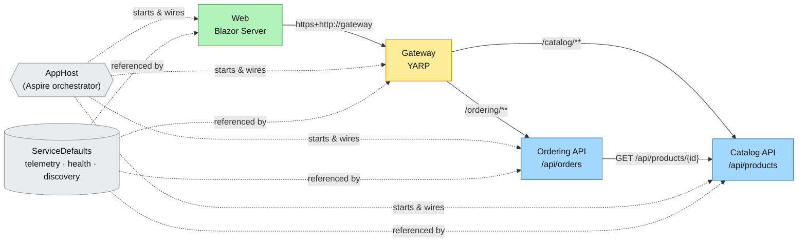
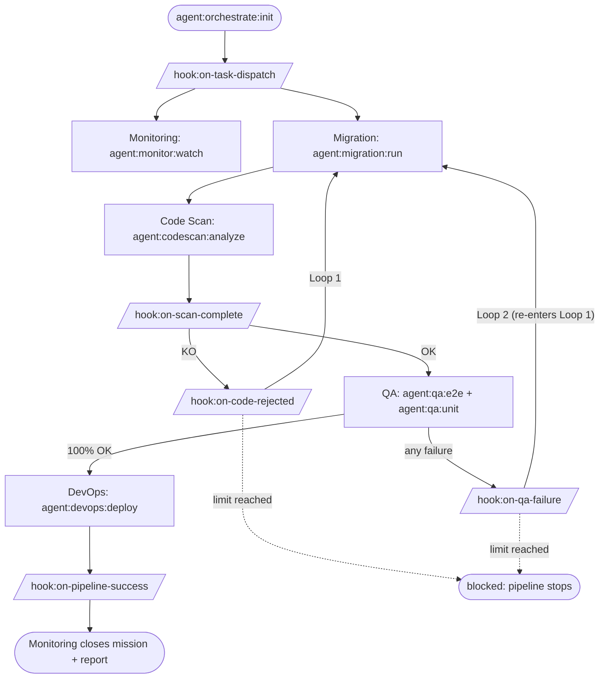
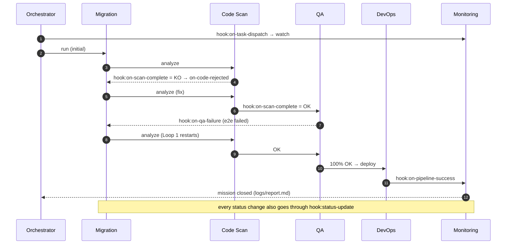
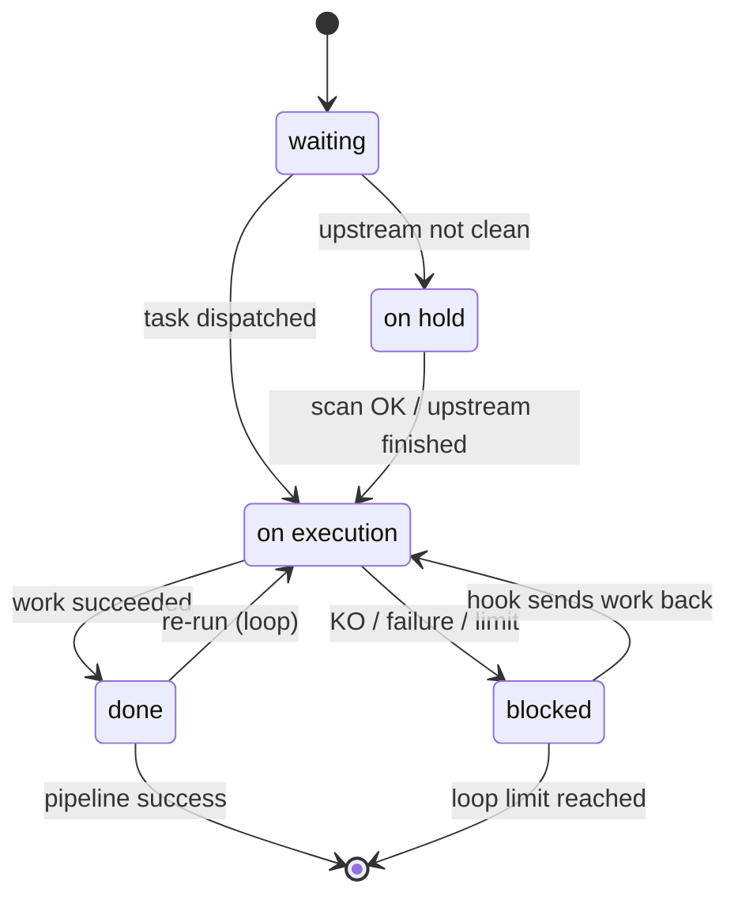
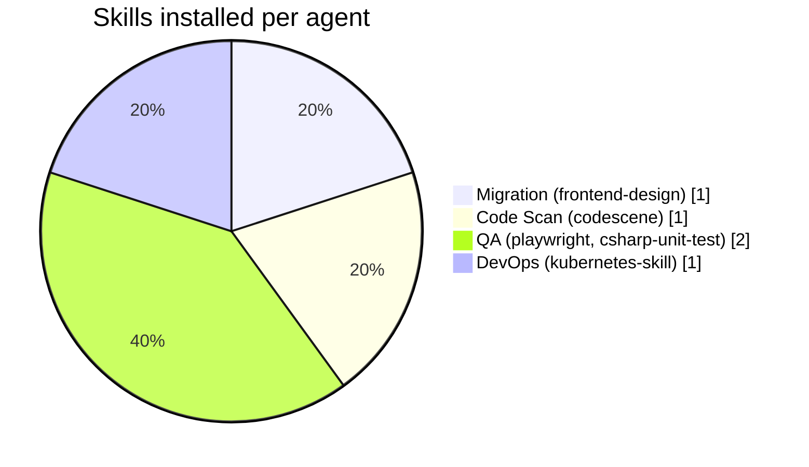
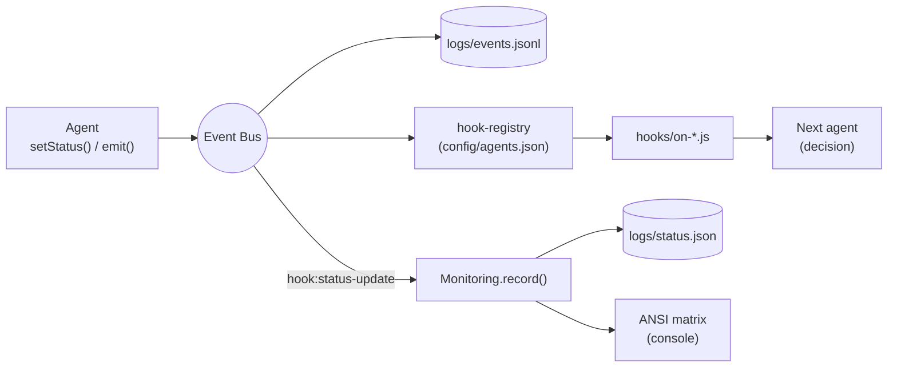

# ECommerce — pipeline autonome à 6 agents

Le dossier `src/` contient l'application .NET 10 / Aspire (Web → Gateway YARP → Catalog / Ordering). Le reste du dépôt contient un **pipeline de 6 agents** reliés par un bus d'événements et des hooks, qui orchestre le cycle migration → scan → QA → déploiement sur cette application. `src/` n'est jamais modifié par le pipeline en mode simulation.

## Prérequis
- Node.js ≥ 18 (aucune dépendance npm)
- Mode `real` uniquement : .NET 10 SDK, `npx playwright`, `kubectl`/`helm`

## Lancer le pipeline complet
```bash
npm run skills:install          # une fois : installe les 5 skills (ou scripts/install-skills.sh / .ps1, --dry-run pour prévisualiser)
npm start                       # = node orchestrator/cli.js run
node scripts/monitor-matrix.js  # (autre terminal) suit logs/status.json en direct
```
Sorties : matrice colorée en console, journal d'événements `logs/events.jsonl`, rapport final `logs/report.md`. Code de sortie 0 = succès, 1 = échec.

Scénarios de démonstration (mode simulation) :
```bash
node orchestrator/cli.js run --fail-scan=2   # 2 rejets Code Scan → hook:on-code-rejected ×2, puis OK
node orchestrator/cli.js run --fail-qa=1     # échec QA → retour Migration → boucle 1 rejouée → OK
node orchestrator/cli.js run --fail-scan=99  # budget de boucle épuisé → Code Scan/Monitoring blocked, exit 1
node orchestrator/cli.js run --fast          # sans délai simulé
node orchestrator/cli.js run --mode=real     # exécute les vraies commandes de config/pipeline.json
```

## Agents, commandes et hooks
| Agent | Skill | Commandes | Hook |
|---|---|---|---|
| Orchestrator | — | `agent:orchestrate:init` | `hook:on-task-dispatch` |
| Monitoring | — | `agent:monitor:watch` | `hook:status-update` |
| Migration | frontend-design | `agent:migration:run` | `hook:on-code-rejected` |
| Code Scan | codescene | `agent:codescan:analyze` | `hook:on-scan-complete` |
| QA | playwright, csharp-unit-test | `agent:qa:e2e`, `agent:qa:unit` | `hook:on-qa-failure` |
| DevOps | kubernetes-skill | `agent:devops:deploy` | `hook:on-pipeline-success` |

Chaque commande est aussi un script npm (`npm run agent:qa:unit`) ; lancée seule, la chaîne de hooks qui suit se déclenche normalement.

## Flux
```
init ─▶ hook:on-task-dispatch ─▶ Monitoring watch
 │
 ▼                       KO: hook:on-code-rejected
Migration ─▶ Code Scan ─▶ hook:on-scan-complete ──┐ (retour Migration jusqu'à OK)
 ▲                              │ OK              │
 │                              ▼                 │
 └── hook:on-qa-failure ◀── QA (E2E + unit) ◀─────┘
                                │ 100 % OK
                                ▼
                       DevOps deploy ─▶ hook:on-pipeline-success ─▶ rapport + clôture
```
Garde-fous : `maxScanIterations` (5) et `maxQaIterations` (3) dans `config/pipeline.json` ; au-delà, le pipeline s'arrête (`blocked`).

## Statuts de la matrice
`on execution` (jaune) · `on hold` (bleu) · `done` (vert) · `blocked` (rouge) · `waiting` (gris)

## Structure
- `agents/` — un module par agent (`_base.js` : statut + exécution simulée/réelle)
- `hooks/` — un module par `hook:*`, liés via `config/agents.json`
- `orchestrator/` — `event-bus.js`, `hook-registry.js`, `cli.js`
- `config/` — `agents.json`, `pipeline.json` (mode, limites, simulation, commandes réelles), `skills.json`
- `scripts/` — `monitor-matrix.js`, `install-skills.sh|ps1`
- `.claude/agents/` — les 6 agents comme sous-agents Claude Code

## Notes
- Le health-check CodeScene local passe par un serveur MCP à configurer séparément (non installable via `npx skills`).
- Les skills sont des dépôts tiers : vérifier leur contenu avant usage ; un échec d'installation n'arrête pas le script.

---

# Project details

## The application (`src/`)
.NET 10 microservices e-commerce demo orchestrated by .NET Aspire.

| Project | Role |
|---|---|
| `ECommerce.AppHost` | Aspire orchestrator — the project you run (`dotnet run --project src/ECommerce.AppHost`) |
| `ECommerce.ServiceDefaults` | Shared telemetry, health checks, resilience, service discovery |
| `ECommerce.Gateway` | YARP reverse proxy, routes `/catalog/**` and `/ordering/**` (configured in `appsettings.json`) |
| `ECommerce.Catalog.Api` | Products API (`/api/products`), EF Core InMemory, seeded at startup |
| `ECommerce.Ordering.Api` | Orders API (`/api/orders`), validates products against Catalog over HTTP |
| `ECommerce.Web` | Blazor Server frontend, calls the services through the Gateway |

Flow: `Web → Gateway → { Catalog, Ordering }` and `Ordering → Catalog`. Aspire resource names (`catalog`, `ordering`, `gateway`) are the service-discovery hostnames. Data is in-memory and lost on restart. See `CLAUDE.md` and each project's README for details.

---

# User guide: using the 6 agents, feature by feature

Two ways to use the agents. Use the **pipeline** to rehearse or automate the whole cycle, and the **sub-agents** (`.claude/agents/*.md`, invoked from Claude Code) to do real work on a real feature.

| Mode | How | Use it when |
|---|---|---|
| Pipeline (`npm start`) | Runs all 6 agents with loops and a live matrix | You want the full cycle, traceability, a report |
| Sub-agents in Claude Code | Ask Claude Code to "use the `<agent>` agent to …" | You are building a feature and want each role's judgement |

## The recipe for any feature

Follow the same order as the pipeline. Replace the bracketed parts with your feature.

1. **Orchestrator — plan and dispatch**
   > Use the `orchestrator` agent to plan the feature "[feature]": list the steps and which agent does each.
   - Or start the automated cycle: `npm start` (watch it with `node scripts/monitor-matrix.js` in a second terminal).
2. **Migration — build it**
   > Use the `migration` agent to implement "[feature]" in `src/` (API endpoint, EF Core model change, Blazor page).
   - Uses the `frontend-design` skill for UI. It must end with `dotnet build src/ECommerce.AppHost` passing.
3. **Code Scan — gate quality**
   > Use the `codescan` agent to review my changes and return `VERDICT: OK` or `VERDICT: KO` with findings.
   - **KO →** go back to step 2 and paste the findings (this is Loop 1). Repeat until OK.
4. **QA — validate**
   > Use the `qa` agent to write and run unit tests (`dotnet test src`) and an E2E test (Playwright) for "[feature]".
   - **Any failure →** back to step 2 with the failing test output (Loop 2), then re-run step 3 and 4. Done only at 100% OK.
5. **DevOps — ship it**
   > Use the `devops` agent to containerise/update Helm manifests for the services touched by "[feature]" and validate with `helm lint` / `kubectl --dry-run=client`.
6. **Monitoring — report**
   > Use the `monitoring` agent to summarise `logs/status.json` and `logs/events.jsonl`.
   - The pipeline also writes `logs/report.md` when it finishes.

## Worked examples (per feature)

| Feature | Migration | Code Scan | QA | DevOps |
|---|---|---|---|---|
| **Product search** | `GET /api/products?q=` in Catalog, route through Gateway, search box on `Products.razor` | Check no N+1 / duplicated filtering | Unit-test the filter, E2E: type a query, see results | No change unless a new service/config is added |
| **Stock check at order time** | Ordering rejects quantity > `AvailableStock` (uses `CatalogServiceClient`) | Check error handling of the HTTP call | Unit: over-quantity → 400; E2E: failing order shows a message | Nothing new |
| **Order status page** | New `Orders.razor` filters/colours via `OrderStatus` | Check component size/complexity | E2E: create order then see it listed | Nothing new |
| **New microservice (e.g. Reviews)** | New project, add to `AppHost.cs`, add route + cluster in Gateway `appsettings.json`, call `AddServiceDefaults()` | Check it follows the existing Catalog layout | Unit + E2E through the Gateway | Add its Deployment/Service and Gateway route to the Helm chart |
| **DB migration (replace InMemory)** | Add a real provider + EF migrations for one service | Check no connection strings in code | Re-run all unit/E2E against the real DB | Add DB and secrets to manifests |

## Using the pipeline commands directly

```bash
npm start                                  # full cycle
node orchestrator/cli.js agent:codescan:analyze    # one agent (its hooks still fire, chain continues)
node orchestrator/cli.js run --fail-scan=2         # rehearse Loop 1 (two KOs, then OK)
node orchestrator/cli.js run --fail-qa=1           # rehearse Loop 2
node orchestrator/cli.js run --mode=real           # run the real commands instead of simulating
```

Reading the matrix: yellow `on execution` · blue `on hold` · green `done` · red `blocked` · gray `waiting`. A red `blocked` Code Scan or QA means that agent returned KO; the hook then sends work back to Migration. If Migration/Code Scan stay blocked after the iteration limit (`config/pipeline.json`), the cycle stops and `logs/report.md` explains why.

## Tips
- Keep one feature per cycle: smaller diffs make Code Scan and QA verdicts clearer.
- Give Migration the exact KO findings or failing test output, not a summary.
- Real mode needs .NET 10, Playwright and `kubectl`/`helm`; simulate mode needs only Node.
- Install the skills once with `npm run skills:install` (third-party repos: review them first).

---

<!-- docs:sync:start -->
## Project inventory (auto-generated)

Kept in sync by the Docs & Sync agent after each successful deployment (last base commit: `e5bec10`). Full details: [docs/TECHNICAL.md](docs/TECHNICAL.md).

- **Projects (6):** `AppHost`, `Catalog.Api`, `Gateway`, `Ordering.Api`, `ServiceDefaults`, `Web`
- **Endpoints (6):** `GET /api/products`, `GET /api/products/{id:int}`, `POST /api/products`, `GET /api/orders`, `GET /api/orders/{id:int}`, `POST /api/orders`
- **Gateway routes:** `/catalog/{**catch-all}` → catalog-cluster, `/ordering/{**catch-all}` → ordering-cluster
<!-- docs:sync:end -->

---

# Diagrams

Mermaid diagrams render directly on GitHub and in most Markdown viewers. The Excalidraw versions (editable, hand-drawn style) are in [`docs/diagrams/`](docs/diagrams/): open them at [excalidraw.com](https://excalidraw.com) (menu → *Open*) or with the VS Code "Excalidraw" extension.

| Excalidraw file | Content |
|---|---|
| [`architecture.excalidraw`](docs/diagrams/architecture.excalidraw) | Aspire microservices: Web, Gateway, Catalog, Ordering, AppHost, ServiceDefaults |
| [`agent-pipeline.excalidraw`](docs/diagrams/agent-pipeline.excalidraw) | The 6 agents with Loop 1 (scan KO) and Loop 2 (QA failure) |
| [`event-flow.excalidraw`](docs/diagrams/event-flow.excalidraw) | Agent → event bus → hook → next agent, plus the monitoring path |

## 1. Application architecture



## 2. Agent pipeline and feedback loops



## 3. One cycle with a scan rejection and a QA failure



## 4. Status lifecycle of an agent (monitoring matrix)



## 5. Skills per agent



## 6. Event bus internals


