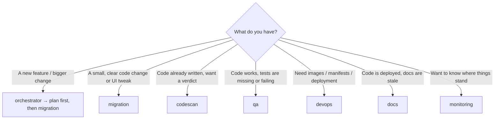

## How to use the agents to build a new feature

This is the hand-written playbook. It lives in `config/usage-guide.md` and is copied into this file by the Docs & Sync agent, so edit it there.

### 0. What the agents really do

Two layers exist, and it matters which one you are using:

| Layer | What it is | Writes code? |
|---|---|---|
| **Claude Code sub-agents** (`.claude/agents/*.md`) | Roles you invoke by prompt inside Claude Code: `orchestrator`, `migration`, `codescan`, `qa`, `devops`, `docs`, `monitoring` | **Yes** — this is where the feature is actually built |
| **Pipeline** (`npm start`, `node orchestrator/cli.js …`) | Node event bus + hooks that run the gates and loops, with a live status matrix | **No** — in `simulate` mode it fakes the work; in `--mode=real` it only runs `dotnet build`, `dotnet test`, `npx playwright test`, `kubectl` and the git steps |

Rule of thumb: **build the feature with the sub-agents, then let the pipeline prove it is green and document it.**

### 1. Which agent do I start with?



| Starting point | Agent | Skill it relies on | Typical first prompt |
|---|---|---|---|
| New feature, unclear scope | `orchestrator` | – | *Use the orchestrator agent to plan "[feature]": affected services, steps, which agent does each.* |
| Implement / change code, DB, UI | `migration` | `frontend-design` (Blazor UI) | *Use the migration agent to implement …* |
| Quality gate | `codescan` | `codescene` | *Use the codescan agent to review my changes; end with VERDICT: OK or KO.* |
| Unit + E2E tests | `qa` | `csharp-unit-test`, `playwright` | *Use the qa agent to write and run tests for …* |
| Containers, Helm, deploy | `devops` | `kubernetes-skill` | *Use the devops agent to …* |
| Refresh README, docs, diagrams | `docs` | – | `npm run agent:docs:sync` |
| Status / history | `monitoring` | – | *Use the monitoring agent to summarise logs/status.json.* |

Install the skills once: `npm run skills:install` (they are third-party repos — read them first). Name the skill in your prompt when it matters, e.g. *"Use the frontend-design skill for the page layout."*

### 2. The feature workflow, step by step

1. **Plan (orchestrator).** Give it the feature, the acceptance criteria and constraints. Ask for the list of touched services and the agent order.
2. **Build (migration).** Paste the plan's step for this agent. It must finish with `dotnet build src/ECommerce.AppHost` passing.
3. **Gate (codescan).** `VERDICT: OK` → continue. `KO` → copy the findings **verbatim** back to `migration` (**Loop 1**) and re-scan. Repeat until OK.
4. **Validate (qa).** Unit tests (`dotnet test src`) and an E2E test through the Gateway. Any failure → paste the failing output to `migration` (**Loop 2**), then redo steps 3 and 4. Done only at 100% OK.
5. **Ship (devops).** Only after QA is 100% OK. Ask for manifest/image changes limited to the services you touched, validated with `helm lint` / `kubectl --dry-run=client` before any real apply.
6. **Document (docs).** Runs automatically after a successful deployment (`hook:on-pipeline-success` → `hook:on-deploy-validated`). It refreshes this file, the README inventory block and the `.excalidraw` diagrams, then commits and pushes in `--mode=real`.

To run the gates and loops automatically instead of by hand: `npm start` (watch it with `node scripts/monitor-matrix.js` in a second terminal). Rehearse the loops with `--fail-scan=N` / `--fail-qa=N`.

### 3. Prompt templates (copy, fill the brackets)

A good prompt always states: **the goal, the services/files involved, the acceptance criteria, and the constraints** (see section 5).

**Orchestrator — plan**
```
Use the orchestrator agent to plan the feature "[name]".
Goal: [what the user can do afterwards]
Acceptance criteria: [observable behaviours, error cases]
Services likely involved: [Catalog / Ordering / Gateway / Web]
Return: ordered steps, which agent runs each, and what "done" means for each.
```

**Migration — implement**
```
Use the migration agent to implement step [n] of the plan: [step text].
Work only in [src/ECommerce.X.Api, src/ECommerce.Web/Components/Pages/Y.razor].
Follow the existing layout (Endpoints/*Endpoints.cs, typed clients in Web/Services).
For UI use the frontend-design skill. Finish with `dotnet build src/ECommerce.AppHost`.
```

**Migration — fix after a rejection (Loop 1 / Loop 2)**
```
Use the migration agent to fix the following feedback, change nothing else:
[paste the codescan findings or the failing test output verbatim]
Then re-run `dotnet build src/ECommerce.AppHost`.
```

**Code Scan — review**
```
Use the codescan agent (codescene skill) to review my changes in [paths / git diff].
Check complexity, duplication, error handling and Aspire/Gateway conventions.
End with exactly `VERDICT: OK` or `VERDICT: KO` and numbered, actionable findings.
```

**QA — tests**
```
Use the qa agent to cover "[feature]".
Unit (csharp-unit-test skill): [cases, incl. error paths] → run `dotnet test src`.
E2E (playwright skill): [user journey through the Gateway/Web].
Do not change production code; report failures precisely so migration can fix them.
```

**DevOps — deploy**
```
Use the devops agent (kubernetes-skill) to update the manifests for [services touched].
Keep Aspire resource names as service hostnames. Validate with `helm lint` and
`kubectl apply --dry-run=client`. Do not apply to a real cluster without my confirmation.
```

**Docs — sync**
```
npm run agent:docs:sync                       # simulate: writes files only
node orchestrator/cli.js agent:docs:sync --mode=real --no-push   # real: commit locally, no push
```

### 4. Worked example — "search products by name"

| Step | Agent | Prompt (short) |
|---|---|---|
| 1 | orchestrator | *Plan "search products by name": Catalog endpoint, Gateway reachability, search box on Products page.* |
| 2 | migration | *Add `GET /api/products?q=` in `CatalogEndpoints.cs` (case-insensitive contains). Add `SearchAsync(q)` to `CatalogApiClient` using `/catalog/api/products?q=`. Add a search box to `Products.razor` (frontend-design skill). Build the AppHost.* |
| 3 | codescan | *Review the diff; flag duplicated filtering, missing null/empty handling.* → KO? send findings back to migration |
| 4 | qa | *Unit: empty query returns all, no match returns empty, case-insensitive. E2E: type "laptop" on Products, only matching rows shown.* → failure? back to migration |
| 5 | devops | *No new service: confirm no manifest change is needed.* |
| 6 | docs | Automatic: new `GET /api/products` query behaviour appears in the endpoint table and README inventory |

### 5. Project constraints to put in your prompts

- Aspire **resource names** (`catalog`, `ordering`, `gateway`, `web`) are the service-discovery hostnames. Renaming one means updating `AppHost.cs`, Web/Ordering `Program.cs` and the Gateway `appsettings.json` clusters.
- Web calls everything **through the Gateway**: client paths must include the prefix (`/catalog/...`, `/ordering/...`).
- A **new backend service** needs: `AddProject` + `WithReference` in `AppHost.cs`, `AddServiceDefaults()` / `MapDefaultEndpoints()` in its `Program.cs`, and a route + cluster in `src/ECommerce.Gateway/appsettings.json`.
- Catalog and Ordering use the **EF Core InMemory** database (data resets on restart); `EnsureCreated()` seeds at startup.
- Ordering validates products by calling Catalog (`CatalogServiceClient`); keep that synchronous contract in mind for stock-related features.

### 6. When something goes wrong

| Symptom | Meaning | What to do |
|---|---|---|
| Code Scan `blocked`, hook `on-code-rejected` fired | KO verdict | Feed the exact findings to `migration`; after `maxScanIterations` (5) the pipeline stops |
| QA `blocked`, hook `on-qa-failure` fired | A test failed | Feed the failing output to `migration`; limit `maxQaIterations` (3) |
| Migration `blocked` | `dotnet build` failed | Fix the build first; the scan never runs on a broken build |
| Docs & Sync `blocked` | Generation, commit or push failed | See `logs/events.jsonl` (`docs:failed`); retry with `--no-push` |
| Everything `waiting` | Nothing dispatched yet | Run `npm start` or invoke the first agent |

Reading `logs/`: `events.jsonl` is the full event trail, `status.json` the last matrix, `report.md` the final report.

### 7. Quick checklist

- [ ] Feature described with goal, acceptance criteria, services involved
- [ ] Plan from `orchestrator`
- [ ] `migration` done and the AppHost builds
- [ ] `codescan` returned `VERDICT: OK`
- [ ] `qa` unit + E2E at 100% OK
- [ ] `devops` validated (dry-run) if infra changed
- [ ] `docs` synced (`npm run agent:docs:sync`) and the diff reviewed before pushing

