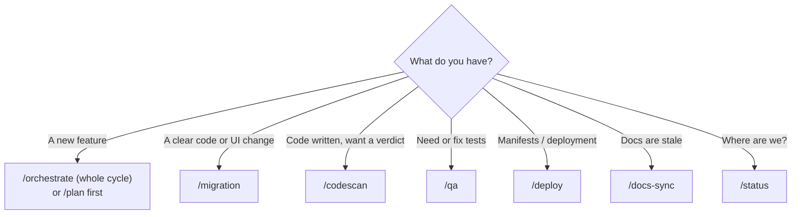
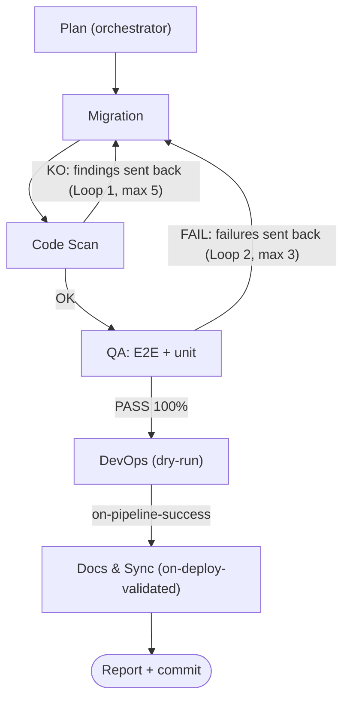
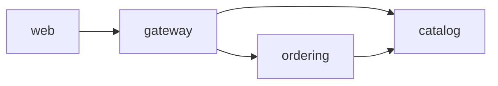

# Technical documentation

Part 1 explains how to use the agents to build a feature. Part 2 is the reference for the application. The Docs & Sync agent keeps Part 2 in line with the code (`/docs-sync`).

---

# Part 1 — Using the agents for a new feature

## 0. How it works

Everything is Markdown read by Claude Code — no scripts:

| Piece | Where | What it is |
|---|---|---|
| 7 sub-agents | `.claude/agents/*.md` | Roles with their own instructions, tools and skills |
| 8 slash commands | `.claude/commands/*.md` | Prompts you type: `/orchestrate`, `/plan`, `/migration`, `/codescan`, `/qa`, `/deploy`, `/docs-sync`, `/status` |
| 5 skills | installed by `scripts/install-skills.sh` or `.ps1` | `frontend-design`, `codescene`, `playwright`, `csharp-unit-test`, `kubernetes-skill` |

**Important:** a sub-agent cannot call another sub-agent. So the loops are run by your **main Claude session**, driven by the `/orchestrate` command: it delegates each step to a sub-agent, passes the findings between them, enforces the loop limits and prints the status matrix. The `orchestrator` sub-agent only produces the plan.

First-time setup: run `scripts/install-skills.sh` (or `scripts\install-skills.ps1`). The skills are third-party repositories — read them before installing. The CodeScene local MCP health check must be configured separately.

## 1. Which command do I start with?



| Situation | Command | Agent | Skill used |
|---|---|---|---|
| New feature, end to end | `/orchestrate <feature>` | all, in order | all |
| Only want a plan | `/plan <feature>` | orchestrator | – |
| Implement / fix code, DB, Blazor UI | `/migration <task>` | migration | frontend-design |
| Quality verdict on a change | `/codescan [paths]` | codescan | codescene |
| Unit / E2E tests | `/qa [unit\|e2e\|all] <feature>` | qa | csharp-unit-test, playwright |
| Manifests and dry-run validation | `/deploy [notes]` | devops | kubernetes-skill |
| Refresh README, docs, diagrams | `/docs-sync [push]` | docs | – |
| Matrix of the last run | `/status` | monitoring | – |

## 2. The cycle (what `/orchestrate` does)



The named handoffs from the spec are plain steps in `orchestrate.md`: `on-task-dispatch` (step 0), `on-scan-complete` / `on-code-rejected` (loop 1), `on-qa-failure` (loop 2), `on-pipeline-success` and `on-deploy-validated` (steps 4–5).

Status matrix, printed after every step and logged to `logs/pipeline-run.md`: 🟡 on execution · 🔵 on hold · 🟢 done · 🔴 blocked · ⚪ waiting. Final report: `logs/pipeline-report.md`.

Safety defaults: DevOps validates with dry-run only; Docs & Sync commits locally and pushes only if you add `push`; nothing is applied to a cluster without your confirmation.

## 3. Prompts to copy

The best prompts state **goal, files/services involved, acceptance criteria, constraints**.

**Whole feature**
```
/orchestrate Search products by name. Users type in a box on the Products page and see matching rows.
Acceptance: case-insensitive contains; empty query returns all; no match shows "No products".
Services: Catalog (GET /api/products?q=), Web (Products.razor, CatalogApiClient).
```
Add `push` at the end if Docs & Sync should push its commit.

**Plan only**
```
/plan Add a "cancel order" action: Ordering API endpoint, status change, button on Orders page.
```

**Implement one step**
```
/migration Add GET /api/products?q= in CatalogEndpoints.cs (case-insensitive contains) and a
SearchAsync(q) in CatalogApiClient calling /catalog/api/products?q=. Use the frontend-design skill
for the search box on Products.razor.
```

**Send findings back (Loop 1 / Loop 2)**
```
/migration Fix exactly this and nothing else:
<paste the codescan findings or the failing tests verbatim>
```

**Review / tests / deploy / docs**
```
/codescan src/ECommerce.Catalog.Api focus on duplicated filtering and null handling
/qa all Search products: empty query, no match, case-insensitive; E2E: type "laptop" and see only matches
/deploy Catalog and Web changed; no new service
/docs-sync
```

You can also talk to an agent directly: *"Use the qa agent to …"*.

## 4. Worked example — "search products by name"

| Step | Command | Expected outcome |
|---|---|---|
| 1 | `/plan Search products by name` | Plan: Catalog filter, `CatalogApiClient.SearchAsync`, Products page box |
| 2 | `/migration …` (from the plan) | Code changed, `dotnet build src/ECommerce.AppHost` passes |
| 3 | `/codescan` | `VERDICT: KO` → send findings with `/migration`, repeat until `OK` |
| 4 | `/qa all Search products …` | `QA RESULT: FAIL` → fix with `/migration`, rerun `/codescan` and `/qa` until `PASS` |
| 5 | `/deploy no new service` | `DEPLOY: READY` (no infra change) |
| 6 | `/docs-sync` | README block, endpoint table and diagrams updated, local commit |

`/orchestrate Search products by name …` does steps 1–6 in one go.

## 5. Project constraints to include in prompts

- Aspire **resource names** (`catalog`, `ordering`, `gateway`, `web`) are the service-discovery hostnames. Renaming one means updating `AppHost.cs`, Web and Ordering `Program.cs`, and the Gateway `appsettings.json` clusters.
- Web calls everything **through the Gateway**: client paths include `/catalog/...` or `/ordering/...`.
- A **new service** needs `AddProject` + `WithReference` in `AppHost.cs`, `AddServiceDefaults()` / `MapDefaultEndpoints()` in `Program.cs`, and a route + cluster in `src/ECommerce.Gateway/appsettings.json`.
- Catalog and Ordering use the **EF Core InMemory** database (reset on restart); `EnsureCreated()` seeds at startup.
- Ordering validates products synchronously through `CatalogServiceClient`.

## 6. When something goes wrong

| Symptom | Meaning | Action |
|---|---|---|
| Code Scan 🔴 | `VERDICT: KO` | Send the findings verbatim to migration; stops after 5 iterations |
| QA 🔴 | `QA RESULT: FAIL` | Send the failures verbatim to migration, then rescan and retest; stops after 3 iterations |
| Migration 🔴 | `dotnet build` fails | Fix the build first; the scan never runs on a broken build |
| DevOps 🔴 | `DEPLOY: BLOCKED` | Read the dry-run error and fix the manifests |
| Docs & Sync 🔴 | Edit or commit failed | Check `git status`; rerun `/docs-sync` |
| Agent not found | Agents are loaded at session start | Restart Claude Code or run `/agents` |
| Skill missing | Not installed | Run `scripts/install-skills.sh` |

## 7. Checklist

- [ ] Feature described with goal, acceptance criteria, services
- [ ] Plan reviewed
- [ ] `dotnet build src/ECommerce.AppHost` passes
- [ ] `VERDICT: OK`
- [ ] `QA RESULT: PASS` (unit + E2E)
- [ ] Deployment manifests validated (dry-run)
- [ ] `/docs-sync` run and its diff reviewed before pushing

---

# Part 2 — Application reference

## Projects

| Project | Kind | Aspire resource | References |
|---|---|---|---|
| `ECommerce.AppHost` | Aspire AppHost | – | Catalog.Api, Ordering.Api, Gateway, Web |
| `ECommerce.Catalog.Api` | ASP.NET Core app | catalog | ServiceDefaults |
| `ECommerce.Gateway` | ASP.NET Core app (YARP) | gateway | ServiceDefaults |
| `ECommerce.Ordering.Api` | ASP.NET Core app | ordering | ServiceDefaults |
| `ECommerce.ServiceDefaults` | Library | – | – |
| `ECommerce.Web` | ASP.NET Core app (Blazor Server) | web | ServiceDefaults |

## Service dependency graph (from `AppHost.cs`)



## HTTP endpoints

| Service | Method | Path |
|---|---|---|
| Catalog | GET | `/api/products` |
| Catalog | GET | `/api/products/{id:int}` |
| Catalog | POST | `/api/products` |
| Ordering | GET | `/api/orders` |
| Ordering | GET | `/api/orders/{id:int}` |
| Ordering | POST | `/api/orders` |

## Gateway routes

| Route | Public path | Target |
|---|---|---|
| catalog-route | `/catalog/{**catch-all}` | `https+http://catalog` |
| ordering-route | `/ordering/{**catch-all}` | `https+http://ordering` |

The prefix is removed before forwarding (`PathRemovePrefix`).
